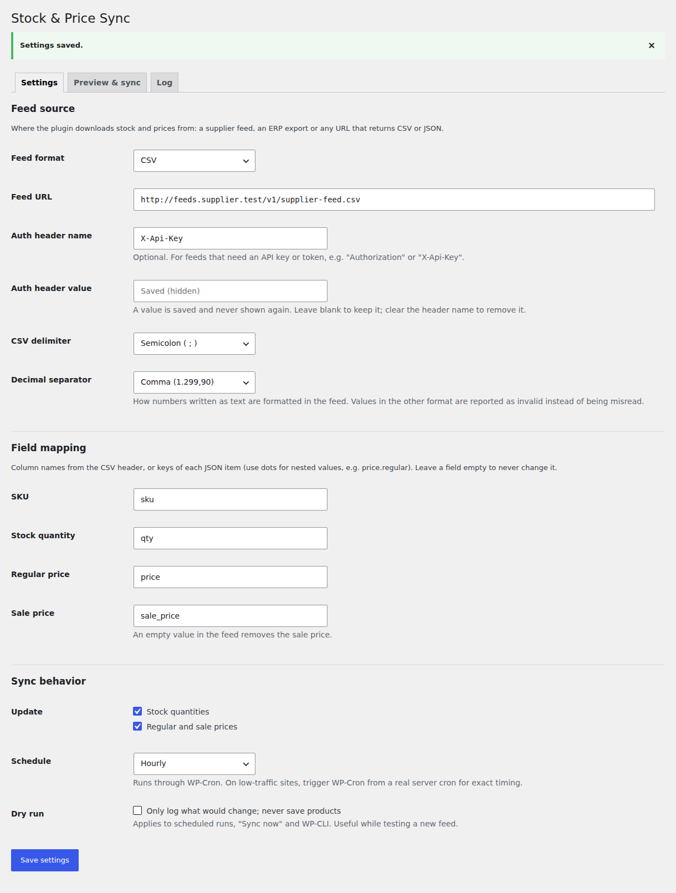
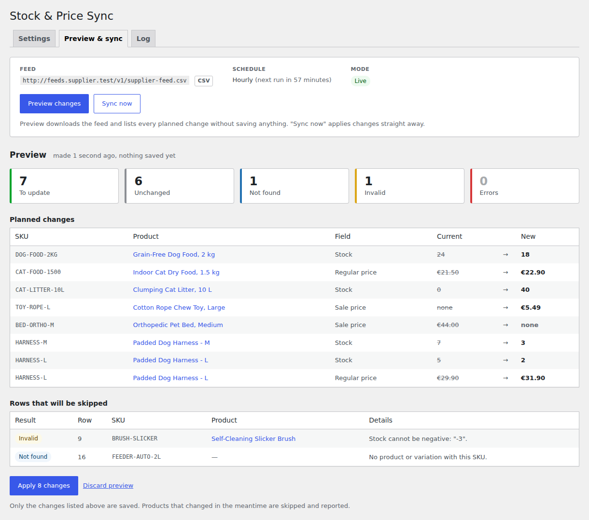
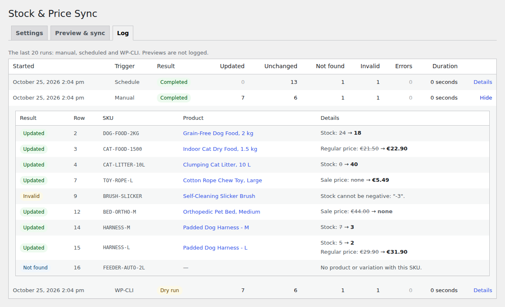
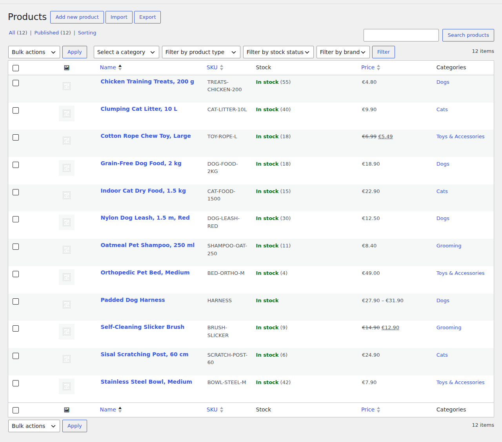

# Stock & Price Sync for WooCommerce

Keep WooCommerce stock levels and prices in line with a supplier feed or an ERP export. The plugin downloads a CSV or JSON file from a URL, matches rows to products **and variations** by SKU, shows exactly what would change, and applies only the differences through the WooCommerce CRUD API. Every run is logged.


Typical use: a shop that resells a wholesaler's catalogue, or a business whose ERP is the source of truth for stock and prices, and which today copies numbers into WooCommerce by hand or with a fragile import every morning.

## Features

- **CSV or JSON feeds** from any URL, with an optional auth header (`Authorization`, `X-Api-Key`, ...). CSV delimiter (comma, semicolon, tab, pipe), UTF-8 BOM from Excel exports, quoted values and CRLF line endings are handled. For JSON, the list of items can sit at a nested path such as `data.items`.
- **Field mapping**: tell the plugin which column (or JSON key, with dot notation like `price.regular`) holds the SKU, stock, regular price and sale price. Leave a field unmapped and it is never touched.
- **Matches simple products and variations by SKU** (`wc_get_product_id_by_sku`). Products that are not in the feed are left alone.
- **Strict validation.** Negative stock, `N/A`, `12.9O`, a zero price ("price on request" in many feeds) or a price written with the wrong decimal separator are rejected and reported, never imported. The decimal separator is a setting, so `1.299,00` and `1,299.00` are both read correctly and `12,5` in a dot-decimal feed is flagged instead of becoming 125.
- **Diff first, write second.** Only changed fields are saved; unchanged products are not even re-saved. `18.9` in the store and `18.90` in the feed count as equal.
- **Preview, then apply exactly what you saw.** "Preview changes" lists every planned change (SKU, product, field, current, new) without saving anything. "Apply" saves that plan, not a fresh download, and skips any product whose values changed in the meantime (an order came in, someone edited it).
- **Sync log** of the last 20 runs in a custom table: time, trigger (manual, schedule, WP-CLI), counts for updated / unchanged / not found / invalid / errors, and per-row details.
- **Scheduling** through WP-Cron: every 15 minutes (custom interval), hourly, twice daily or daily. Rescheduled when the setting changes, removed on deactivation.
- **Dry-run mode** for scheduled runs, "Sync now" and WP-CLI while you test a new feed.
- **WP-CLI**: `wp wsps sync [--dry-run]` prints every change and a summary table.
- **Safe to run unattended:** an atomic database lock prevents overlapping runs, rows are processed in batches with the in-memory cache released between batches, one bad row never stops the rest of the feed, and an oversized (cut-off) download is rejected instead of half-imported.
- **Safe to configure:** feeds are fetched with `wp_safe_remote_get()`, so the URL field cannot be pointed at internal services, and the saved API key is dropped when the feed host changes, so it cannot be sent to another server.
- **Clean WordPress citizen:** `manage_woocommerce` capability and nonces on every action, sanitized input and escaped output, translation-ready, HPOS compatible, no notices with `WP_DEBUG` on, everything removed on uninstall.

## Screenshots

**Settings:** feed URL, auth header, CSV options, field mapping and schedule.



**Preview:** planned changes and the rows that will be skipped (unknown SKU, invalid value), nothing saved yet.



**Log:** the last runs from the admin screen, the schedule and WP-CLI, with per-row details.



**Result:** the WooCommerce product list after the sync (new stock levels, prices and sale prices).



## How it works

```
fetch (wp_remote_get, timeout, auth header)
  -> parse (CsvParser / JsonParser)
  -> map + validate each row (FeedItemFactory, NumberParser)
  -> match by SKU (wc_get_product_id_by_sku: simple products and variations)
  -> diff against the current product (DiffCalculator)
  -> apply in batches via WooCommerce CRUD (set_stock_quantity, set_regular_price, ... save)
  -> store the report (custom table, last 20 runs)
```

Every feed row ends up with exactly one result:

| Result | Meaning |
|---|---|
| Updated | At least one field changed (in a dry run: "To update"). |
| Unchanged | The product already matches the feed. |
| Not found | No product or variation has this SKU. |
| Invalid | The row was rejected: missing SKU, negative or non-numeric value, zero price, sale price higher than the regular price, duplicate SKU, malformed CSV row. The whole row is skipped. |
| Error | The product exists but could not be updated (for example a variable parent product, or WooCommerce refused to save). |

The parsing, mapping, validation and diff logic lives in WordPress-independent classes (`src/Feed`, `src/Sync/DiffCalculator.php`, `src/Sync/SyncReport.php`), so it is unit tested without loading WordPress.

## Requirements

- WordPress 6.5 or later
- WooCommerce 8.0 or later (built and tested with WooCommerce 11.2.1 on WordPress 7.1.3)
- PHP 8.1 or later

## Installation

1. Download `stock-price-sync-for-woocommerce.zip` (or build it with `bin/build-zip.sh`).
2. In WordPress go to **Plugins > Add New > Upload Plugin**, choose the zip and activate it. WooCommerce must be active.
3. Open **WooCommerce > Stock Sync**.

From source: clone this repository into `wp-content/plugins/stock-price-sync-for-woocommerce`. The plugin has its own autoloader, so no `composer install` is needed to run it.

## Configuration

| Setting | Description |
|---|---|
| Feed format | CSV or JSON. |
| Feed URL | `http://` or `https://` URL of the feed, up to 50 MB. Loopback and private network addresses are refused; for an ERP on your internal network, allow its host with WordPress' `http_request_host_is_external` filter (see [Hooks](#hooks)). |
| Auth header name / value | Optional header sent with the request, e.g. `X-Api-Key`. The value is write-only in the form: it is never printed back into the page, and it is removed when the feed URL moves to another host. |
| CSV delimiter | Comma, semicolon, tab or pipe. |
| JSON items path | Dot-separated path to the list of items, e.g. `data.items`. Empty when the document itself is the list. |
| Decimal separator | Dot (`1,299.90`) or comma (`1.299,90`) for numbers written as text. Native JSON numbers are always fine. |
| Field mapping | Column name or JSON key for SKU (required), stock, regular price and sale price. Leave a field empty to never change it. |
| Update | Stock quantities and/or regular and sale prices. |
| Schedule | Off, every 15 minutes, hourly, twice daily or daily. The first run happens one interval after saving, so there is time to preview first. |
| Dry run | Scheduled runs, "Sync now" and WP-CLI only log what would change. |

### Rules for values

- A mapped column that is **missing from the CSV header** stops the run with a clear message listing the columns that were found (usually a wrong delimiter or a typo in the mapping). For JSON, the same happens when no item has the mapped SKU, stock or regular price key.
- **Empty stock or regular price**: the field is left alone.
- **Empty sale price** (or JSON `null`): the sale price is removed, i.e. the supplier ended the promotion. If you manage sales in WooCommerce yourself, do not map the sale price.
- A JSON key that is **absent** from an item leaves the field alone.
- **Sale price equal to the regular price** means "no sale" (many ERPs export it that way) and is stored as empty. A sale price **higher** than the regular price makes the row invalid.
- **A price of 0** makes the row invalid, because feeds often use 0 for "price on request". Allow it with the `wsps_allow_zero_prices` filter.
- Stock must be a whole number from 0 to 999,999,999. Setting stock turns on "Track stock quantity" for that product (for a variation this means its own stock rather than the parent's); WooCommerce then updates the stock status itself.
- Prices are rounded to the store's number of decimals.

## Feed examples

CSV with semicolons and decimal commas, as exported by many European spreadsheets and ERPs ([examples/supplier-feed.csv](examples/supplier-feed.csv)). Mapping: SKU `sku`, stock `qty`, regular price `price`, sale price `sale_price`; delimiter semicolon; decimal separator comma.

```csv
sku;name;qty;price;sale_price
DOG-FOOD-2KG;Grain-Free Dog Food, 2 kg;18;18,90;
TOY-ROPE-L;Cotton Rope Chew Toy, Large;18;6,99;5,49
BRUSH-SLICKER;Self-Cleaning Slicker Brush;-3;14,90;12,90
HARNESS-M;Padded Dog Harness, M;3;29,90;
```

JSON with nested prices ([examples/supplier-feed.json](examples/supplier-feed.json)). Mapping: items path `items`, SKU `sku`, stock `stock`, regular price `price.regular`, sale price `price.sale`.

```json
{
  "supplier": "Example Wholesale",
  "items": [
    { "sku": "DOG-FOOD-2KG", "stock": 18, "price": { "regular": 18.90, "sale": null } },
    { "sku": "TOY-ROPE-L", "stock": 18, "price": { "regular": 6.99, "sale": 5.49 } }
  ]
}
```

## WP-CLI

```
wp wsps sync [--dry-run]
```

Runs a sync with the saved settings, prints every change and skipped row, then a summary (`--quiet` prints nothing, for cron jobs). The run is stored in the log with the trigger "WP-CLI". The exit code is 1 when the run fails: feed unavailable or unreadable, or another run in progress. Real output from the demo store below:

```
$ wp wsps sync --dry-run
Dry run: nothing will be saved.
+-----------+-----+----------------+-----------------------------+---------------+---------+-------+---------------------------------+
| result    | row | sku            | product                     | field         | current | new   | note                            |
+-----------+-----+----------------+-----------------------------+---------------+---------+-------+---------------------------------+
| To update | 2   | DOG-FOOD-2KG   | Grain-Free Dog Food, 2 kg   | Stock         | 24      | 18    |                                 |
| To update | 3   | CAT-FOOD-1500  | Indoor Cat Dry Food, 1.5 kg | Regular price | 21.50   | 22.90 |                                 |
| To update | 4   | CAT-LITTER-10L | Clumping Cat Litter, 10 L   | Stock         | 0       | 40    |                                 |
| To update | 7   | TOY-ROPE-L     | Cotton Rope Chew Toy, Large | Sale price    | none    | 5.49  |                                 |
| Invalid   | 9   | BRUSH-SLICKER  | Self-Cleaning Slicker Brush |               |         |       | Stock cannot be negative: "-3". |
| To update | 12  | BED-ORTHO-M    | Orthopedic Pet Bed, Medium  | Sale price    | 44.00   | none  |                                 |
| To update | 14  | HARNESS-M      | Padded Dog Harness - M      | Stock         | 7       | 3     |                                 |
| To update | 15  | HARNESS-L      | Padded Dog Harness - L      | Stock         | 5       | 2     |                                 |
| To update | 15  | HARNESS-L      | Padded Dog Harness - L      | Regular price | 29.90   | 31.90 |                                 |
| Not found | 16  | FEEDER-AUTO-2L |                             |               |         |       | No product with this SKU        |
+-----------+-----+----------------+-----------------------------+---------------+---------+-------+---------------------------------+
+---------+-----------+-----------+---------+-------+
| updated | unchanged | not_found | invalid | error |
+---------+-----------+-----------+---------+-------+
| 7       | 6         | 1         | 1       | 0     |
+---------+-----------+-----------+---------+-------+
Success: Dry run finished, nothing was saved. To update: 7, unchanged: 6, not found: 1, invalid: 1, errors: 0.
```

## Hooks

| Hook | Type | Description |
|---|---|---|
| `wsps_fetch_args` | filter | Arguments passed to `wp_remote_get()` for the feed request. Receives `$args, $url`. |
| `wsps_fetch_timeout` | filter | Request timeout in seconds. Default 30. |
| `wsps_batch_size` | filter | Rows processed per batch. Default 50. |
| `wsps_allow_zero_prices` | filter | Return `true` to import prices of 0. Default `false`. |
| `http_request_host_is_external` | core filter | Allow a feed on an internal host, e.g. `add_filter( 'http_request_host_is_external', fn( $ok, $host ) => $ok \|\| 'erp.office.lan' === $host, 10, 2 );` |
| `wsps_sync_completed` | action | Fires after every logged run with the `WSPS\Sync\SyncReport`, e.g. to send a notification when a run has errors. |

## Development

Unit tests (PHPUnit 10, no WordPress needed) and coding standards (WordPress Coding Standards 3) run in Docker, so nothing has to be installed locally:

```bash
# Install dev dependencies
docker run --rm -v "$PWD":/app -w /app composer:2 composer install

# Unit tests
docker run --rm -v "$PWD":/app -w /app php:8.2-cli php vendor/bin/phpunit

# WordPress Coding Standards
docker run --rm -v "$PWD":/app -w /app php:8.2-cli php vendor/bin/phpcs
```

### Demo environment

`docker-compose.yml` starts WordPress (PHP 8.2), MariaDB, WP-CLI and a small nginx container that plays the supplier's feed server (it serves `examples/` and requires an `X-Api-Key` header). A demo-only must-use plugin (`docker/mu-plugins/`) allows that container's private address through `http_request_host_is_external`.

```bash
bin/demo-setup.sh                      # start, install WordPress + WooCommerce, seed 12 demo products
# http://localhost:8088/wp-admin  (admin / admin, local only)
# Feed URL for the settings screen: http://feeds.supplier.test/v1/supplier-feed.csv
# Auth header: X-Api-Key = demo-key-2026

docker compose -p wsps-demo run --rm cli wp wsps sync --dry-run
docker compose -p wsps-demo down -v    # remove everything
```

The sample feed differs from the demo store on seven products and contains one unknown SKU and one invalid value, so a preview shows every kind of result.

### Build the plugin zip

```bash
bin/build-zip.sh        # -> build/stock-price-sync-for-woocommerce.zip, from the committed code
```

Development files (tests, Docker, screenshots, Composer files) are excluded through `export-ignore` in `.gitattributes`.

### Project structure

```
stock-price-sync-for-woocommerce.php   Plugin header, constants, autoloader, hooks
uninstall.php                          Removes options, transients, cron event and the log table
src/
  Plugin.php, Installer.php            Bootstrap, activation, deactivation, DB upgrades
  Settings.php, Scheduler.php          Settings API option and sanitizing, WP-Cron
  Messages.php                         Translated labels and messages
  Feed/                                WordPress-independent: CSV/JSON parsing, mapping, number validation
  Sync/                                Diff and report (WordPress-independent), sync service,
                                       feed fetcher, WooCommerce product access, lock
  Log/LogRepository.php                Custom table for the run log
  Admin/AdminPage.php                  Admin screen and form handlers
  Cli/SyncCommand.php                  wp wsps sync
views/                                 Admin templates
css/, js/                              Admin styles and a small script (no dependencies)
tests/Unit/                            PHPUnit tests
examples/                              Sample CSV and JSON feeds
docker-compose.yml, docker/, bin/      Demo environment and build script
```

## Uninstall

Deleting the plugin from the Plugins screen removes its settings, the scheduled event, the per-user preview transients and the `wsps_sync_log` table (on every site of a multisite network). Deactivating only stops the schedule.

## License

[GPL-2.0-or-later](LICENSE)
